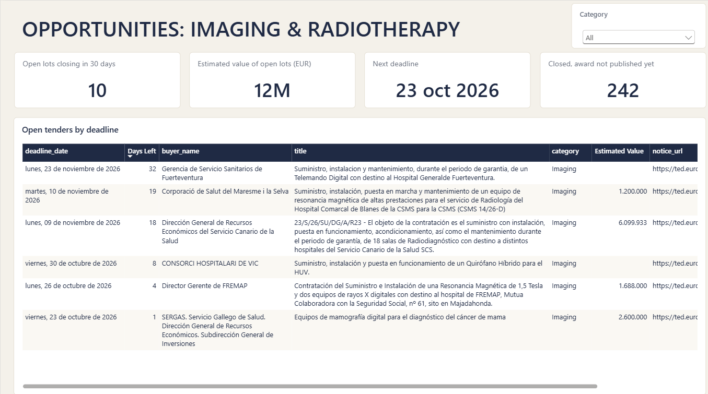

# Medtech Public Tender Intelligence (Spain)

Spanish public tenders for medical imaging and radiotherapy equipment, collected every week from the EU TED API, cleaned in Azure SQL and shown in Power BI for a medtech sales / tender team.

```
TED API -> raw JSON -> CSV -> Azure SQL (staging -> core -> view) -> Power BI
                 weekly with GitHub Actions
```

Data: Oct 2024 to Oct 2026, 525 notices, 820 real lots after removing repeated notices.

## What the report answers

| Page | Question |
|---|---|
| Open lots | Which tenders can we still bid on, and when do they close? |
| Market & buyers | Who buys, how much, and which contracts end in the next 12 months? |
| Competitors & pricing | Who wins, with what share, at what price vs the estimate? |
| Pipeline health | Did the last run work and can we trust the data? |



## Findings (Oct 2024 - Oct 2026)

1. **Three companies lead the market.** GE (18.2%), Siemens (15.0%) and Philips (11.2%) win 44% of the awarded value, out of 132 winners.
2. **Competition lowers the price.** Lots with one bidder are awarded at 100% of the estimate (median). With 3 or more bidders the median is 84%.
3. **A few buyers hold the budget.** The top 10 of 101 buyers account for 43% of the awarded value, led by the Canary Islands health service (19.0 M EUR) and SERGAS (11.3 M EUR).
4. **The data has gaps.** 242 closed lots have no published award yet and 15.2 M EUR was awarded without a winner name, so market share only counts known winners.

Awarded value is not revenue. TED only covers tenders above the EU threshold.

## How it works

- **Extract:** `src/extract/extract.py` downloads notices from the TED Search API for a date window.
- **Transform:** `src/transform/flatten.py` turns the JSON into a notice CSV and a lot CSV.
- **Load:** `src/load/load_staging.py` inserts new rows only, so a rerun adds nothing.
- **Model (SQL):** `sql/03_load` fills buyer, supplier, notice and lot tables. `sql/05_kpi/01_v_lot_latest.sql` keeps one row per real lot: estimate and deadline from the latest competition notice, winner and value from the latest result notice.
- **Checks:** `sql/04_dq/01_dq_checks.sql` saves 4 data quality checks every run.
- **Automation:** `src/run_pipeline.py` runs everything for the last 14 days and writes one row in `etl_run_log`. `.github/workflows/weekly.yml` runs it every Monday.

### Name cleaning

The same company appears with many spellings (GE Healthcare has 11). `dbo.clean_name` removes accents, punctuation and the legal form, and `seeds/name_alias.csv` fixes typos the rule can't fix. Suppliers go from 208 spellings to 143 companies. Without it Siemens looks like the market leader; with it GE is first.

## Setup

```powershell
python -m venv .venv
.venv\Scripts\Activate.ps1
pip install -r requirements.txt
```

Copy `.env.example` to `.env` with your Azure SQL details. Then create the database objects once:

1. `sql/01_staging/01_create_staging.sql`
2. the files in `sql/02_core`, in number order
3. `python src/load/load_seed.py`
4. `sql/05_kpi/01_v_lot_latest.sql`

Run the pipeline:

```powershell
python src/run_pipeline.py
```

For GitHub Actions add the secrets `SQL_SERVER`, `SQL_DB`, `SQL_USER` and `SQL_PASSWORD`. The Azure SQL firewall is open to all IPs because the runner IP changes every time; the database only holds public TED data and is protected by the login.

Power BI: open `powerbi/tender_report.pbip` (Power BI Project, import mode).

## Folders

- `src` – Python: extract, transform, load, pipeline
- `sql` – staging, core tables, loads, data quality, view for Power BI
- `seeds` – CPV codes in scope and name aliases
- `powerbi` – report and model as text files (PBIP)
- `docs` – field map and screenshots

## Limits

- Only tenders above the EU threshold published on TED.
- A notice with both imaging and radiotherapy codes is shown as Imaging.
- "Contracts ending in 12 months" is contract date (or award date) plus duration, so it is an estimate.
- No personal contact data is stored.
